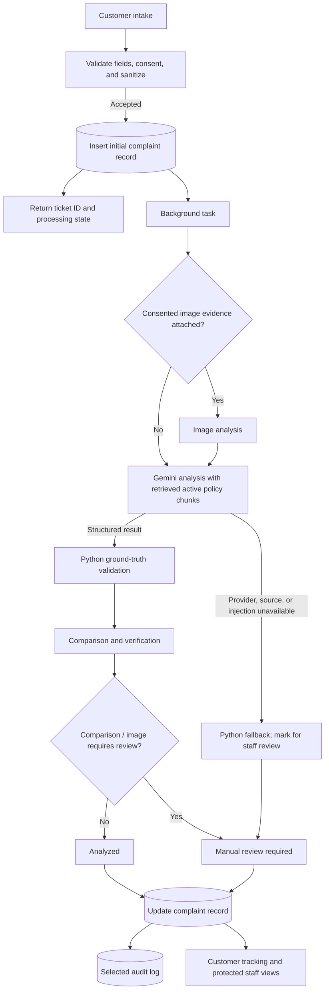
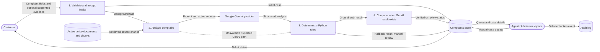
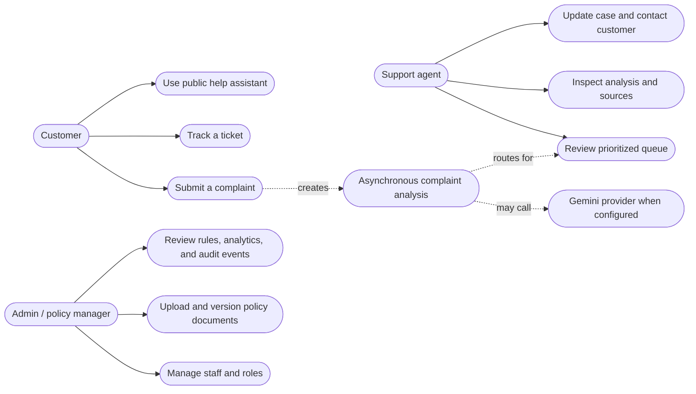
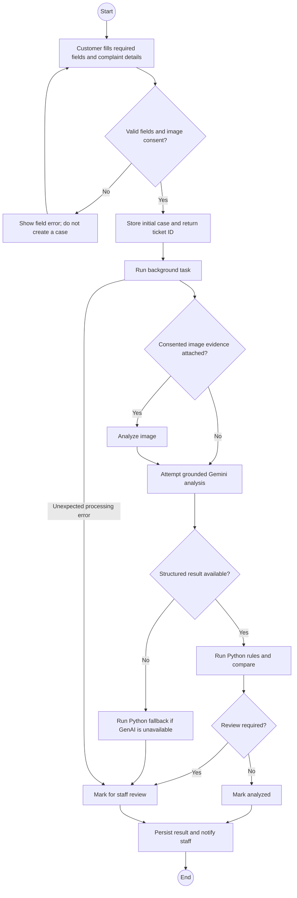

# SupportNova - Comprehensive Project Report
**Techwiz 7: The World Tech Championship**  
**Theme:** ResponseX Intelligence | **Category:** Generative AI PowerPlay  
**Organization:** NovaTech Global Commerce & Electronics  
**Version:** 1.0 (Development Snapshot; not a production-readiness certification)

---

## 1. Problem Definition & Industry Background

Customer service teams in omnichannel enterprises receive tens of thousands of complaints each month across web forms, emails, chat systems, and customer service portals. These complaints range from simple tracking queries to critical life-safety hazards (e.g., lithium battery swelling or electrical short-circuits) and sensitive legal threats.

Traditional complaint handling suffers from severe bottlenecks:
1. **Manual Triage Delays**: Customer service agents spend 10–25 minutes reading, categorizing, looking up policy documents, and identifying the correct department.
2. **Inconsistent Policy Enforcement**: Human agents frequently misinterpret refund windows (e.g. applying obsolete 14-day rules instead of active 30-day rules) or offer unauthorized goodwill compensations.
3. **Overlooked Critical Safety & Escalation Triggers**: Frontline agents often fail to recognize high-risk safety warnings (such as battery expansion) or legal risks hidden in unstructured text.
4. **The "Raw LLM" Trap**: Deploying ungrounded Generative AI directly to customers creates massive risks of hallucinated policies, unauthorized financial promises, and prompt injection exploits.

---

## 2. Proposed Solution: Dual-Pipeline Architecture

SupportNova solves this with an enterprise-grade **Dual-Pipeline Architecture**:
- **Pipeline 1 (GenAI Complaint Intelligence Pipeline)**: Integrates with configured Google Gemini API keys using bounded rotation. Provider outages do not generate synthetic GenAI findings; affected cases are routed to human review while deterministic Python ground truth remains available.
- **Pipeline 2 (Python Ground-Truth Validation Pipeline)**: An independent deterministic Python validation engine with **178 complaint rules**, **36 named escalation conditions**, and the project policy library.
- **Comparison & Verification Engine**: Measures alignment between GenAI output and Ground Truth. It calculates a **Mandatory Policy Coverage Score %**, **Source Traceability Score %**, and flags unauthorized promises, policy contradictions, and prompt injections.
- **Customer Privacy & Trust Preservation**: The public portal includes a separate help assistant. Staff-only GenAI analysis, deterministic findings, and comparison details remain in the protected support workspace; automated analysis is decision support, not a final warranty or refund decision.

---

## 3. System Architecture & Component Design



The engines are independent in implementation, not parallel in orchestration. The background task calls Gemini first; after a valid GenAI result, it runs Python validation and comparison. If GenAI is unavailable, Python findings are persisted and the case is marked for manual review. Other unexpected processing errors also fail to manual review.

### Required Design Diagrams

#### Data-Flow Diagram (DFD)



#### Use-Case Diagram (Actor–Goal View)



#### Activity Diagram



#### Sequence Diagram

```mermaid
sequenceDiagram
    autonumber
    actor Customer
    participant Browser as Customer portal
    participant API as FastAPI intake
    participant DB as Complaints store
    participant Audit as Audit log
    participant BG as Background task
    participant Vision as Image analysis
    participant KB as Active policy retrieval
    participant GenAI as GenAI pipeline
    participant Gemini as Gemini provider
    participant Rules as Python rules
    participant Compare as Comparison engine
    participant Staff as Staff workspace

    Customer->>Browser: Submit valid details and consent if attaching evidence
    Browser->>API: POST complaint form
    API->>API: Validate fields; derive title when blank or too short
    API->>DB: Insert initial trackable case
    API->>BG: Schedule analysis task
    API-->>Browser: Return ticket ID and processing status
    opt Valid consented image attached
        BG->>Vision: Analyze image before text pipeline
        Vision-->>BG: Visual notes and review flag
    end
    BG->>GenAI: Inspect input and prepare grounded request
    GenAI->>KB: Retrieve active policy chunks
    KB-->>GenAI: Active chunks or no eligible source
    GenAI->>Gemini: Request structured analysis when safe and configured
    alt GenAI result is available
        Gemini-->>GenAI: Structured analysis
        GenAI-->>BG: Validated result
        BG->>Rules: Validate complaint deterministically
        Rules-->>BG: Ground-truth result
        BG->>Compare: Compare both results
        Compare-->>BG: Verification and review status
    else GenAI unavailable due to missing configuration, unsafe input/source, or provider exhaustion
        GenAI-->>BG: Unavailable / rejected
        BG->>Rules: Run deterministic fallback
        Rules-->>BG: Ground-truth result; human review remains required
    end
    BG->>DB: Update existing case
    BG->>Audit: Insert selected analysis event
    BG-->>Staff: Broadcast case status when available
```

---

## 4. Database Schema & Data Models

SupportNova connects to MongoDB Atlas through `MONGODB_URI` in hosted deployments. The local JSON store is for local development; hosted startup refuses to fall back to ephemeral storage. Neither behavior guarantees 100% uptime; deployment persistence depends on the host's storage configuration.

### Key Collections:
1. `complaints`: Stores full complaint submissions, entity metadata, customer tier, GenAI intelligence output, Python Ground-Truth result, and comparison verdict.
2. `knowledge_documents`: Stores 21 policy-version records (20 active and one superseded) with version-control metadata and precedence scores.
3. `document_chunks`: Traceable chunk collection indexed by `document_id`, `section_id`, `heading`, and page numbers.
4. `rule_matrix`: 178 deterministic complaint resolution rules.
5. `escalation_rules`: 36 named escalation conditions and thresholds.
6. `audit_logs`: Application audit records for selected automated triage and manual agent actions; immutability is not guaranteed.

---

## 5. Security & Prompt Injection Defense

SupportNova treats all customer-submitted text and file attachments as **untrusted data**.
1. **Fencing Wrappers**: Complaint inputs are framed within strict markdown boundary fencing (`<<<UNTRUSTED_TEXT_START>>>`).
2. **Regex Pattern Inspection**: `PromptDefense` scans input for prompt injection vectors; suspicious complaint text is stopped before provider submission and routed to human review.
3. **Adversarial Compensation Trap Mitigation**: Prohibits GenAI models from executing customer demands for unauthorized refunds or financial compensation.

---

## 6. Verification Metrics & Compliance Audit

| Requirement | Specification Target | SupportNova Achieved | Verification Status |
| :--- | :--- | :--- | :--- |
| Complaint Records (unique IDs) | >= 500 | **528 records** | ✅ Meets target |
| Category / Subcategory / Department coverage | >= 10 / >= 20 / >= 8 | **12 / 21 / 8** | ✅ Meets numeric target; synthetic expected labels are rule-derived, not independent human annotations |
| Difficult dataset cases | >= 25 multi-issue / >= 20 incomplete / >= 20 policy conflicts | **30 / 25 / 20** | ✅ Included |
| Complaint Categories | >= 10 | **12 Categories** | ✅ Meets target |
| Complaint Subcategories | >= 20 | **21 in the bundled dataset** | ✅ Meets target |
| Responsible Departments | >= 8 | **8 distinct expected departments in the bundled dataset** | ✅ Meets target |
| Policy Documents (PDF/DOCX) | >= 20 | **21 policy-version records (20 active, one superseded; 42 PDF/DOCX files)** | ✅ Meets target |
| Resolution Rules Matrix | >= 100 | **178 Ground-Truth Rules** | ✅ Meets target |
| Mandatory Escalations | >= 30 | **36 Conditions** | ✅ Meets target |
| Prompt Injection Test Cases | >= 20 | **25 marked cases; 25/25 detected locally** | ✅ Dataset detector check; not an independent security audit |
| Automated Test Suite | All Passing | **137 passed** | ✅ Verified locally on October 16, 2026; provider-backed and full browser interaction tests remain separate |

---

## 7. Conclusion

SupportNova demonstrates a design for combining generative analysis with deterministic review controls. This development snapshot does not certify zero hallucinations, zero vulnerabilities, production reliability, or live provider performance. The 150-row comparison report and 525-row hidden-evaluation CSV are historical artifacts; neither has verified input provenance proving 100 unseen cases or live Gemini output. Performance under 20 seconds, scale to 10,000 complaints/1,000 policies, and 99% uptime have not been load-tested or measured. The complaint tracker is an initial React component; the remaining dashboards still use server-rendered HTML and JavaScript, so the full React-component and file-size requirements in `docs/rules.md` remain unmet.

The current Git history shows activity on four calendar dates, not all five competition days. No team-contribution record or independent team sign-off is present. Two voice-over videos are included and their representative frames were inspected, but they have not been verified against every required demonstration scenario. Automated route and behavior tests do not constitute an exhaustive manual test of every live button and workflow.
